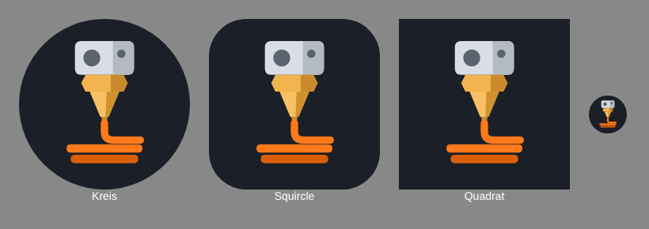
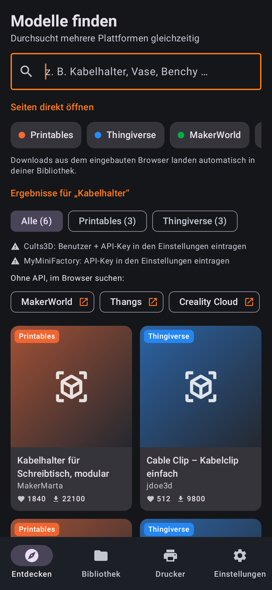
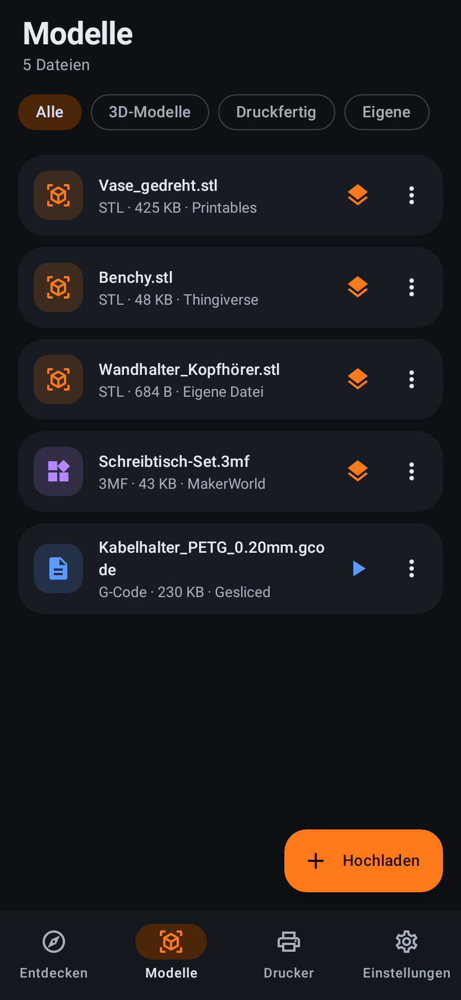
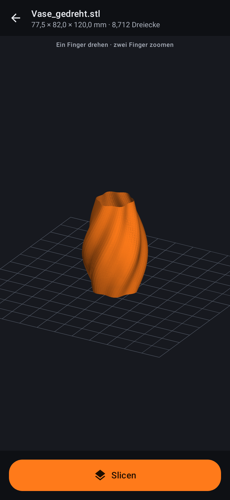
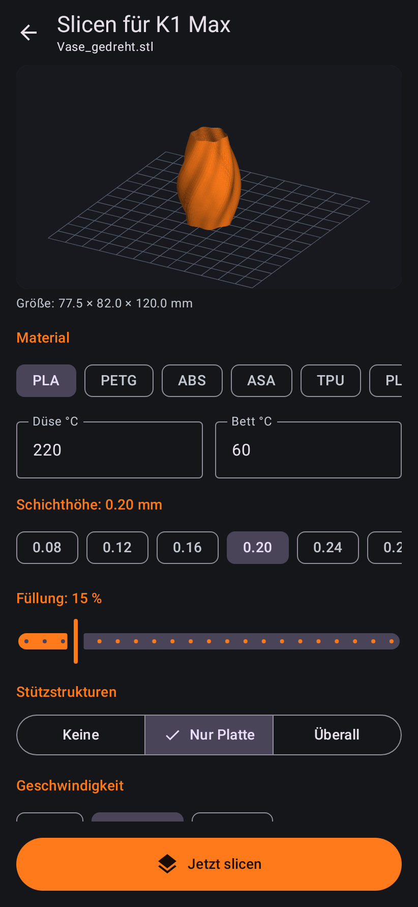
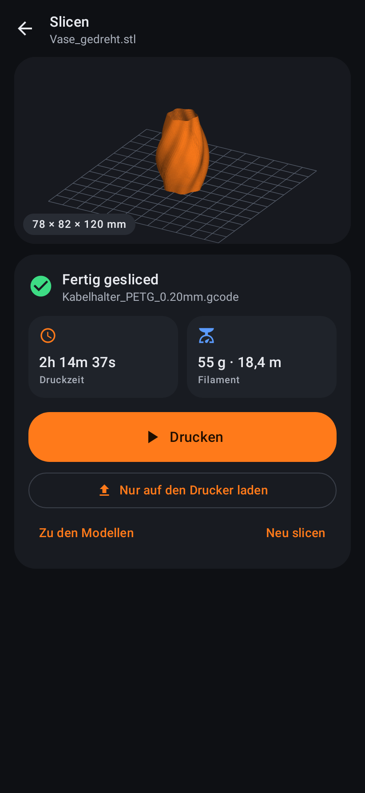
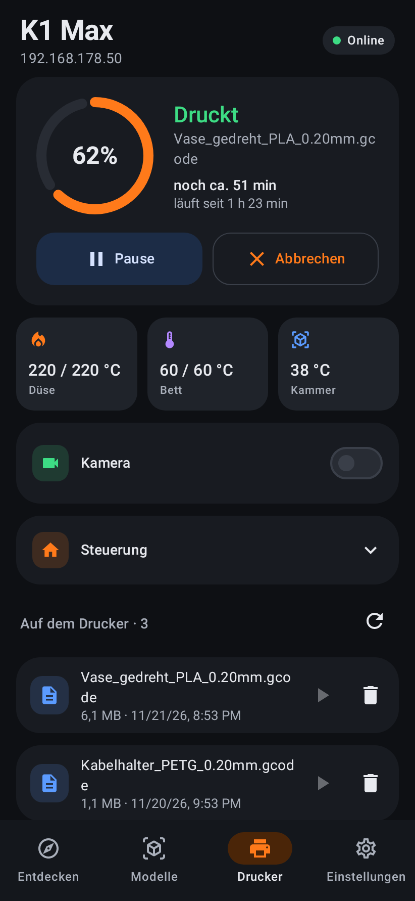
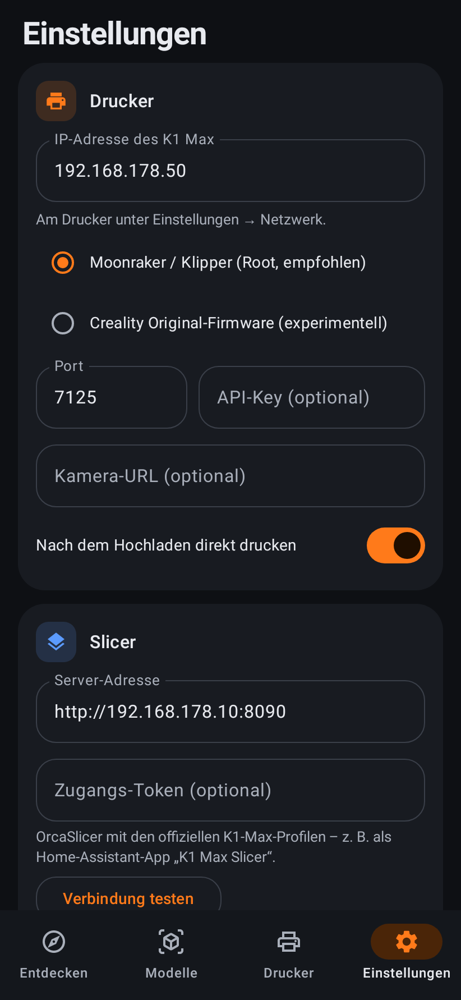

# K1 Max Direkt

Android-App für den **Creality K1 Max**: Modelle von den großen 3D-Druck-Plattformen finden,
herunterladen, slicen und direkt an den Drucker schicken – alles vom Handy aus.

## Vorschau




| Entdecken | Bibliothek | 3D-Vorschau | Slicen |
|---|---|---|---|
|  |  |  |  |

| Fertig gesliced | Drucker | Einstellungen |
|---|---|---|
|  |  |  |

*Die Bilder werden automatisch aus der echten App gerendert (Robolectric + Roborazzi, mit Beispieldaten).*

## Funktionen

| Bereich | Was geht |
|---|---|
| **Entdecken** | Gemeinsame Suche über Printables, Thingiverse, Cults3D und MyMiniFactory. Dazu ein eingebauter Browser für MakerWorld, Thangs, Creality Cloud und alle anderen Seiten. |
| **Downloads** | Jeder Download im eingebauten Browser landet automatisch in der Bibliothek. ZIP-Archive werden entpackt (STL, 3MF, OBJ, STEP, G-Code). Logins bleiben gespeichert. |
| **Eigene Dateien** | Über „Eigene Datei“ selbst erstellte Modelle hochladen, oder aus jeder anderen App per **Teilen → K1 Max Direkt** bzw. **Öffnen mit**. |
| **3D-Vorschau** | STL, 3MF und OBJ drehen und zoomen, mit Druckplatte 300 × 300 mm und Warnung, wenn das Modell nicht passt. |
| **Slicen** | Material (PLA, PETG, ABS, ASA, TPU, PLA-CF), Schichthöhe, Füllung, Stützen, Brim, Wände, Geschwindigkeit, Skalierung, Drehung. Fertiges K1-Max-Profil. |
| **Drucken** | G-Code per Moonraker auf den K1 Max laden und sofort starten. Live-Status mit Fortschritt, Restzeit und Temperaturen (Düse, Bett, Kammer), Pause, Fortsetzen, Abbrechen, NOT-AUS, Vorheizen, Licht, eigene G-Code-Befehle, Kamera-Livebild und die Dateiliste auf dem Drucker. |

## Aufbau

```
app/             Android-App (Kotlin, Jetpack Compose, Material 3)
slicer-server/   Slicer-Server (PrusaSlicer + K1-Max-Profil, Docker)
```

### Warum ein Slicer-Server?
Echte Slicer wie OrcaSlicer, PrusaSlicer oder Cura laufen nicht auf Android. Die App schickt das Modell
deshalb an einen kleinen Server in deinem Heimnetz (PC, NAS, Raspberry Pi, Home-Assistant-Host), der mit
PrusaSlicer und einem K1-Max-Profil slict. Bereits gesliced G-Code (z. B. aus OrcaSlicer am PC) kannst du
auch ohne Server direkt an den Drucker schicken. Einrichtung: [slicer-server/README.md](slicer-server/README.md).

## Drucker-Verbindung

1. **Moonraker (empfohlen):** Am K1 Max unter *Einstellungen → Root-Rechte* Root aktivieren und dann das
   [Creality Helper Script](https://github.com/Guilouz/Creality-Helper-Script) installieren (Moonraker + Fluidd/Mainsail).
   Danach in der App eintragen: IP-Adresse des Druckers, Port `7125`.
2. **Original-Firmware (experimentell):** Status, Pause und Abbrechen laufen über den Creality-WebSocket (Port 9999).
   Das Hochladen ist nicht offiziell dokumentiert und kann je nach Firmware-Version scheitern.

Kamera: Standard ist `http://<drucker>:4408/webcam/?action=stream` (Moonraker) bzw. `:8080/?action=stream` (Original-Firmware).
Unter Einstellungen lässt sich eine eigene URL eintragen.

## Zugänge für die Suche (optional)

| Plattform | Benötigt |
|---|---|
| Printables | nichts |
| Thingiverse | kostenloses App-Token: thingiverse.com/developers |
| Cults3D | Benutzername + API-Key: cults3d.com → Profil → API |
| MyMiniFactory | API-Key: myminifactory.com → Einstellungen → Developer |
| MakerWorld, Thangs, Creality Cloud | keine öffentliche Such-API; laufen über den eingebauten Browser |

Ohne Schlüssel funktionieren alle Seiten trotzdem im eingebauten Browser.

## Bauen

Voraussetzungen: Android Studio (Ladybug oder neuer) bzw. JDK 17 und das Android SDK 35.

```bash
./gradlew assembleDebug      # → app/build/outputs/apk/debug/app-debug.apk
```

Alternativ baut GitHub Actions das APK: **Actions → „APK bauen“ → Run workflow**. Das APK liegt danach als Artefakt bereit.

## Hinweise

* Modelle unterliegen den Lizenzen ihrer Urheber. Bitte die Bedingungen der jeweiligen Plattform beachten.
* Die Such-Schnittstellen von Printables und Co. sind teilweise inoffiziell und können sich ändern. Fällt eine Suche aus,
  funktioniert die Seite weiterhin über den eingebauten Browser.
