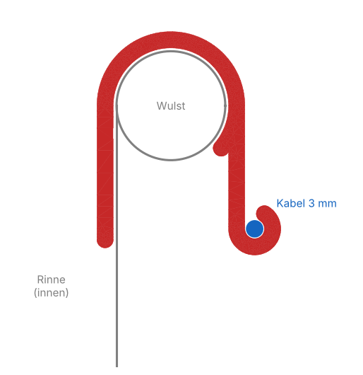
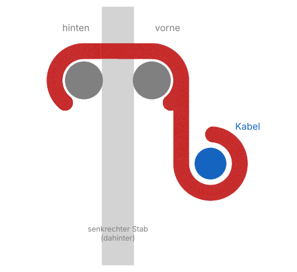
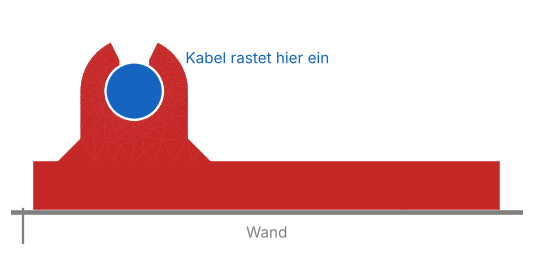
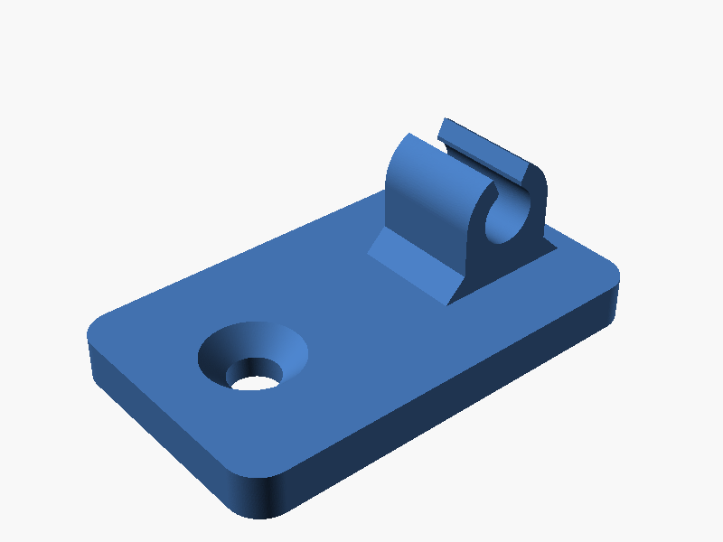
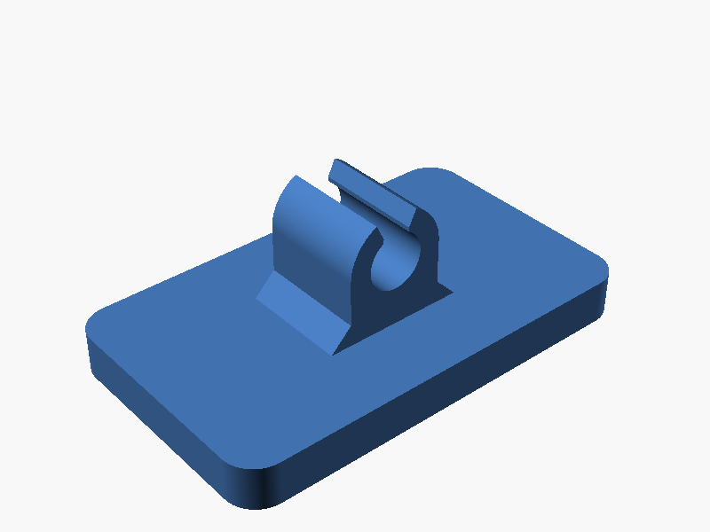

# Haken für Weihnachts-LED-Lichterketten

Vier Haken-Typen zum Drucken auf dem K1 Max, alle ohne Stützstrukturen:

| Datei | Wofür |
|---|---|
| `stl/dachrinnen-haken_wulst-18mm.stl` … `-24mm.stl` | Wird auf den vorderen Wulst einer **halbrunden Dachrinne** gesteckt |
| `stl/zaunhaken-doppelstab_6-5-6.stl` / `_8-6-8.stl` | Wird von oben auf das waagerechte Drahtpaar eines **Doppelstabmattenzauns** gedrückt |
| `stl/wandclip-schrauben_kabel-…mm.stl` | Clip zum **Anschrauben** an Holz (Balken, Verkleidung, Fensterrahmen) oder mit Dübel an die Fassade |
| `stl/wandclip-kleben_kabel-…mm.stl` | Clip zum **Ankleben** mit doppelseitigem Outdoor-Klebeband (glatte Fassade, Fensterrahmen, Kunststoff) |

Alle Haken halten das Kabel so fest, dass es auch bei starkem Wind nicht herausrutscht. Das Kabel wird eingeclipst, und die Öffnung ist schmaler als das Kabel.

Die Haken sind mit **[SolidCraft](https://solidcraft.io)** (Version 0.49.1) gebaut.

| Ordner | Inhalt |
|---|---|
| `solidcraft/*.sc` | SolidCraft-Konstruktionen mit allen Maßen als Parameter. Öffne sie in SolidCraft (Desktop oder [Browser](https://solidcraft.io/app)) und ändere die Werte unter **Parameters**. |
| `solidcraft/*.json` | Die Bauanleitung als SolidCraft-Skript, aus dem die `.sc`-Dateien entstehen |
| `stl/` | Druckfertige STL-Dateien |
| `step/` | Dieselben Teile als STEP, falls du sie in einem anderen CAD weiterbearbeiten willst |

### Maße in SolidCraft ändern

In der App: `.sc`-Datei öffnen, dann **Parameters** öffnen. Die wichtigsten Werte sind als Favoriten markiert, zum Beispiel `wulst_d`, `spiel` und `untergriff` beim Dachrinnen-Haken oder `kabel_d` und `oeffnung` beim Wandclip oder `draht_d` und `stab_d` beim Zaunhaken. Ändere einen Wert, und das Modell baut sich neu auf. Danach als STL exportieren.

Auf der Kommandozeile geht es genauso:
```
solidcraft-cli run --in solidcraft/dachrinnen-haken.sc --param "wulst_d=19 mm" --out mein-haken.stl
```
Mit `solidcraft-cli run solidcraft/dachrinnen-haken.json --save dachrinnen-haken.sc` entsteht die Konstruktion neu aus dem Skript.

## 1. Dachrinnen-Haken



*Rot: Haken, grau: Rinnenwulst und Rinnenwand, blau: Kabel der Lichterkette.*

- Der Bügel greift über den Wulst und ein Stück darunter, damit Wind ihn nicht abhebt.
- Das hintere Bein hängt **innen** in der Rinne und stützt sich an der Rinnenwand ab. Dadurch kann sich der Haken durch das Gewicht der Kette nicht nach vorne drehen.
- Die Kette wird vorne unten in den Haken **eingeclipst**. Oben bleibt nur ein Spalt von ca. 2,4 mm, deshalb kann der Wind das Kabel nicht heraushebeln. Das hält bei Kabeln ab etwa 3 mm. Für dünnere Kabel stellst du `haken_ende` höher ein, zum Beispiel 95°.

**Die richtige Größe auswählen:** Miss den Durchmesser des Wulsts (die eingerollte Kante vorne an der Rinne) mit einem Messschieber und nimm die STL, die am nächsten liegt (18 / 20 / 22 / 24 mm). Bei den gängigen Rinnen NW 280/333 liegt der Wulst meist bei 18–22 mm. Wenn du unsicher bist, druck zuerst einen Testhaken.

Anbringen: das Bein zuerst innen in die Rinne einführen, dann den Haken vorne über den Wulst drücken, bis er einrastet. Ein Haken alle 30–50 cm reicht.

Für eine andere Wulstgröße änderst du in SolidCraft den Parameter `wulst_d` (siehe oben). Sitzt der Haken zu fest oder zu locker, kannst du `spiel` (Standard 0,6 mm) oder `untergriff` (Standard 40°) ändern.

## 2. Zaunhaken für Doppelstabmatten



*Querschnitt: Der Haken (rot) umgreift beide waagerechten Drähte (grau). Das Kabel (blau) wird vorne von oben in die Kabelaufnahme eingeclipst.*

- Der Bügel wird **von oben** auf das waagerechte Drahtpaar gedrückt und rastet unter beiden Drähten ein. Weil er beide Drähte umgreift, kann er sich nicht verdrehen und auch bei Wind nicht abrutschen.
- Setz ihn **zwischen zwei senkrechte Stäbe**. Dort ist zwischen den Drähten Platz, und der Haken ist mit 10 mm Breite schmal genug.
- Die Kabelaufnahme ist dieselbe wie beim Dachrinnen-Haken: Oben bleibt nur ein Spalt von ca. 2,4 mm, das Kabel rastet ein.

**Die richtige Größe auswählen:** Doppelstabmatten gibt es meist in zwei Stärken. Die Zahlen stehen oft auf dem Etikett oder im Kaufbeleg, sonst miss die Drähte mit dem Messschieber.

| Matte | Waagerechte Drähte | Senkrechte Stäbe | Datei |
|---|---|---|---|
| 6/5/6 (leicht, am häufigsten) | 6 mm | 5 mm | `zaunhaken-doppelstab_6-5-6.stl` |
| 8/6/8 (schwer) | 8 mm | 6 mm | `zaunhaken-doppelstab_8-6-8.stl` |

Für andere Maße änderst du in SolidCraft `draht_d` und `stab_d`. Bei dick pulverbeschichteten Zäunen kannst du `spiel` etwas erhöhen, zum Beispiel auf 0,8 mm. Sitzt der Haken zu locker, erhöhe `untergriff`.

## 3. Wandclips (Schrauben oder Kleben)



*Seitenansicht, so wie der Clip an der Wand sitzt: Die Öffnung zeigt nach oben. Du drückst das Kabel (blau) von oben in den Clip, bis es einrastet. Weil die Öffnung schmaler ist als das Kabel, kann der Wind es nicht herausheben.*

**Die richtige Größe auswählen:** Miss die Dicke des Kabels deiner Lichterkette und nimm die passende Datei:

| Kabeldicke | Datei-Endung | Innen-Ø | Öffnung |
|---|---|---|---|
| 2–3 mm | `_kabel-2-3mm.stl` | 3,4 mm | 1,6 mm |
| 3–5 mm | `_kabel-3-5mm.stl` | 5,2 mm | 2,6 mm |
| 5–7 mm | `_kabel-5-7mm.stl` | 7,2 mm | 4,0 mm |

Für jede andere Kabeldicke änderst du in SolidCraft `kabel_d` (Innendurchmesser) und `oeffnung`. Die Öffnung sollte etwa 1–1,5 mm schmaler sein als das Kabel. Lässt sich das Kabel schwer einclipsen, mach `wand` dünner (z. B. 1,6 mm) oder die `oeffnung` etwas breiter.

Montage: Die Platte kommt so an die Wand, dass die Öffnung des Clips nach **oben** zeigt (beim Schraub-Clip ist das Schraubenloch dann oben). Das Kabel läuft waagerecht an der Wand entlang. Ein Clip alle 30–50 cm reicht.

### Zum Schrauben (Holz / Fassade)



- Loch 4,5 mm mit Senkung für **Senkkopfschrauben 3,5–4 mm**.
- Holz: Edelstahl-Holzschraube (A2) 4 × 25 mm.
- Mauerwerk/Putz: 5er- oder 6er-Dübel mit einer 4-mm-Schraube.
- ⚠️ In eine **gedämmte Fassade (WDVS)** solltest du nicht einfach bohren, weil dort Feuchtigkeit in die Dämmung eindringen kann. Nimm dafür die Klebe-Variante oder schraub in Fensterrahmen oder Holzteile.

### Zum Kleben (Fassade)



- Die Rückseite ist die glatte Seite vom Druckbett, darauf hält das Klebeband am besten.
- Nimm doppelseitiges Outdoor-Montageband (z. B. tesa Powerbond Outdoor, 3M VHB) in der Größe 24 × 40 mm.
- Damit es hält: Untergrund sauber, trocken und fettfrei machen (Spiritus). Die meisten Bänder brauchen **mindestens +10 °C** beim Verkleben. Im Winter vorher Untergrund und Clip mit einem Föhn anwärmen und 30 s fest andrücken.
- Auf rauem Putz halten Klebebänder schlecht. Teste vorher an einer Stelle.

## Druckeinstellungen (K1 Max)

| Einstellung | Wert |
|---|---|
| Material | **PETG** oder **ASA** (ASA ist am UV- und wetterfestesten, der geschlossene K1 Max druckt es gut). PLA wird draußen spröde und weich. |
| Ausrichtung | So wie die STL geladen wird (Rinnen- und Zaunhaken liegen flach, Wandclip liegt auf der Platte) |
| Schichthöhe | 0,2 mm |
| Wände | 4 |
| Füllung | 40 % (die dünnen Teile werden ohnehin fast massiv) |
| Stützen | keine (die kleine Lippe über der Clip-Öffnung überhängt nur ca. 2 mm; falls sie beim Drucken hängt, Stützen „nur auf Druckplatte“ einschalten) |
| Brim | nicht nötig, bei ASA wegen Warping optional |

Zeitaufwand: etwa 10–15 min pro Haken. Mehrere Haken passen gleichzeitig aufs Bett.

## Sicherheit

Draußen nur Lichterketten verwenden, die für außen zugelassen sind (mindestens **IP44**). Das Kabel darf nicht gequetscht werden. Stecker und Netzteil gehören nicht in die Rinne, wo sich Wasser sammelt.
