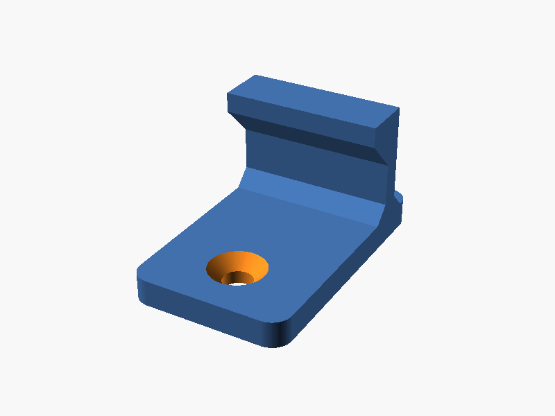
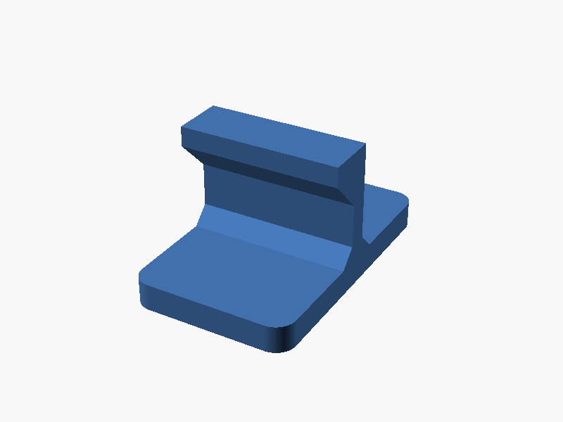

# Haken für Weihnachts-LED-Lichterketten

Drei Haken-Typen zum Drucken auf dem K1 Max, alle ohne Stützstrukturen:

| Datei | Wofür |
|---|---|
| `stl/dachrinnen-haken_wulst-18mm.stl` … `-24mm.stl` | Wird auf den vorderen Wulst einer **halbrunden Dachrinne** gesteckt |
| `stl/wandhaken_schrauben_holz-fassade.stl` | Zum **Anschrauben** an Holz (Balken, Verkleidung, Fensterrahmen) oder mit Dübel an die Fassade |
| `stl/wandhaken_kleben_fassade.stl` | Zum **Ankleben** mit doppelseitigem Outdoor-Klebeband (glatte Fassade, Fensterrahmen, Kunststoff) |

Die Haken sind mit **[SolidCraft](https://solidcraft.io)** (Version 0.49.1) gebaut.

| Ordner | Inhalt |
|---|---|
| `solidcraft/*.sc` | SolidCraft-Konstruktionen mit allen Maßen als Parameter. Öffne sie in SolidCraft (Desktop oder [Browser](https://solidcraft.io/app)) und ändere die Werte unter **Parameters**. |
| `solidcraft/*.json` | Die Bauanleitung als SolidCraft-Skript, aus dem die `.sc`-Dateien entstehen |
| `stl/` | Druckfertige STL-Dateien |
| `step/` | Dieselben Teile als STEP, falls du sie in einem anderen CAD weiterbearbeiten willst |
| `haken.scad` | Ältere OpenSCAD-Version mit denselben Maßen (nur als Alternative) |

### Maße in SolidCraft ändern

In der App: `.sc`-Datei öffnen, dann **Parameters** öffnen. Die wichtigsten Werte sind als Favoriten markiert, zum Beispiel `wulst_d`, `spiel` und `untergriff` beim Dachrinnen-Haken. Ändere einen Wert, und das Modell baut sich neu auf. Danach als STL exportieren.

Auf der Kommandozeile geht es genauso:
```
solidcraft-cli run --in solidcraft/dachrinnen-haken.sc --param "wulst_d=19 mm" --out mein-haken.stl
```
Mit `solidcraft-cli run solidcraft/dachrinnen-haken.json --save dachrinnen-haken.sc` entsteht die Konstruktion neu aus dem Skript.

## 1. Dachrinnen-Haken


*Rot: Haken, grau: Rinnenwulst und Rinnenwand, blau: Kabel der Lichterkette.*

- Der Bügel greift über den Wulst und ein Stück darunter, damit Wind ihn nicht abhebt.
- Das hintere Bein hängt **innen** in der Rinne und stützt sich an der Rinnenwand ab. Dadurch kann sich der Haken durch das Gewicht der Kette nicht nach vorne drehen.
- Die Kette wird vorne unten in den Haken eingeclipst.

**Die richtige Größe auswählen:** Miss den Durchmesser des Wulsts (die eingerollte Kante vorne an der Rinne) mit einem Messschieber und nimm die STL, die am nächsten liegt (18 / 20 / 22 / 24 mm). Bei den gängigen Rinnen NW 280/333 liegt der Wulst meist bei 18–22 mm. Wenn du unsicher bist, druck zuerst einen Testhaken.

Anbringen: das Bein zuerst innen in die Rinne einführen, dann den Haken vorne über den Wulst drücken, bis er einrastet. Ein Haken alle 30–50 cm reicht.

Für eine andere Wulstgröße änderst du in SolidCraft den Parameter `wulst_d` (siehe oben). Sitzt der Haken zu fest oder zu locker, kannst du `spiel` (Standard 0,6 mm) oder `untergriff` (Standard 40°) ändern.

## 2. Wandhaken zum Schrauben (Holz / Fassade)



- Loch 4,5 mm mit Senkung für **Senkkopfschrauben 3,5–4 mm**.
- Holz: Edelstahl-Holzschraube (A2) 4 × 25 mm.
- Mauerwerk/Putz: 5er- oder 6er-Dübel mit einer 4-mm-Schraube.
- ⚠️ In eine **gedämmte Fassade (WDVS)** solltest du nicht einfach bohren, weil dort Feuchtigkeit in die Dämmung eindringen kann. Nimm dafür die Klebe-Variante oder schraub in Fensterrahmen oder Holzteile.
- Montage: Die Platte kommt mit dem Loch nach **oben** an die Wand, die Lippe zeigt nach oben. Das Kabel liegt dann auf dem Arm zwischen Wand und Lippe.

## 3. Wandhaken zum Kleben (Fassade)



- Die Rückseite ist die glatte Seite vom Druckbett, darauf hält das Klebeband am besten.
- Nimm doppelseitiges Outdoor-Montageband (z. B. tesa Powerbond Outdoor, 3M VHB) in der Größe 24 × 40 mm.
- Damit es hält: Untergrund sauber, trocken und fettfrei machen (Spiritus). Die meisten Bänder brauchen **mindestens +10 °C** beim Verkleben. Im Winter vorher Untergrund und Haken mit einem Föhn anwärmen und 30 s fest andrücken.
- Auf rauem Putz halten Klebebänder schlecht. Teste vorher an einer Stelle.

## Druckeinstellungen (K1 Max)

| Einstellung | Wert |
|---|---|
| Material | **PETG** oder **ASA** (ASA ist am UV- und wetterfestesten, der geschlossene K1 Max druckt es gut). PLA wird draußen spröde und weich. |
| Ausrichtung | So wie die STL geladen wird (Rinnenhaken liegt flach, Wandhaken liegt auf der Platte) |
| Schichthöhe | 0,2 mm |
| Wände | 4 |
| Füllung | 40 % (die dünnen Teile werden ohnehin fast massiv) |
| Stützen | keine |
| Brim | nicht nötig, bei ASA wegen Warping optional |

Zeitaufwand: etwa 10–15 min pro Haken. Mehrere Haken passen gleichzeitig aufs Bett.

## Sicherheit

Draußen nur Lichterketten verwenden, die für außen zugelassen sind (mindestens **IP44**). Das Kabel darf nicht gequetscht werden. Stecker und Netzteil gehören nicht in die Rinne, wo sich Wasser sammelt.
